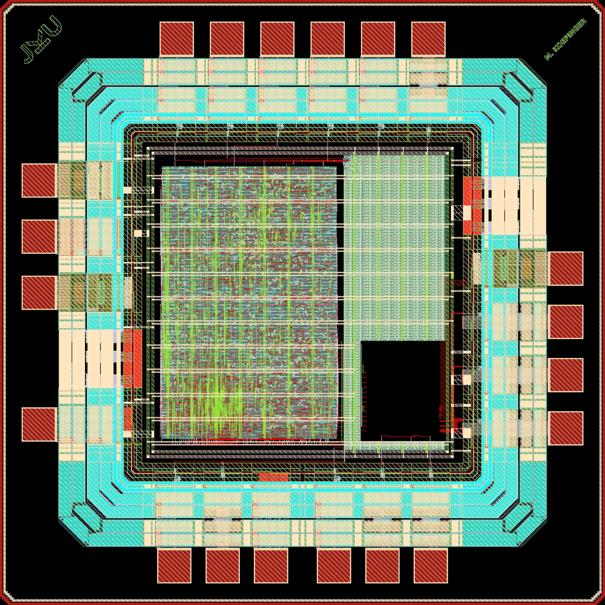

# The DSADC1 Digital Back End on the ihp-sg13cmos5l Open-PDK

[](LICENSE)

(c) 2026 Michael Koefinger

Institute for Integrated Circuits and Quantum Computing, Johannes Kepler University (JKU), Linz, Austria

The chip carries the digital back end of the DSADC1 delta-sigma ADC: the 128x decimation filter, the SPI slave and the configuration register file, hardened on ETH Zurich's EZ130 8T standard cells and assembled into a 32-pad QFN32 die.

The flow, the directory layout and the two example macros come from the [ihp-sg13cmos5l AMS chip template](https://github.com/iic-jku/ihp-sg13cmos5l-ams-chip-template) by Simon Dorrer and Harald Pretl, Apache-2.0 WITH SHL-2.1. `CITATION.cff` records that lineage and the per-file SPDX headers keep it accurate.

> [!IMPORTANT]
> The EZ130 8T cell library is a prerelease and is **not** part of this repository. The macro builds read it in place from `EZ130_DIR`, which defaults to `$(HOME)/projects/OpenBLAU/ip/ez130_8t_v1p1`, and the thick-oxide decoupling from `DECAPHV_DIR`. Without them `make -C macros/decimator librelane` stops in `check-ez130`.

> [!IMPORTANT]
> Every target runs inside the [IIC-OSIC-TOOLS](https://github.com/iic-jku/IIC-OSIC-TOOLS) container, tag `2026.08` or later, the one the sign-off ran on, with `PDK=ihp-sg13cmos5l`. A parse-time guard in each `Makefile` stops the run if the PDK is wrong.

<p align="center">
  <a href="render/img/sg13cmos5l_dsa1_dig_top_black.png">
    
  </a>
  <br>
  <em>sg13cmos5l_dsa1_dig_top, 1.6 mm x 1.6 mm.</em>
</p>


## What is on the die

| | |
|---|---|
| Technology | IHP SG13CMOS5L, Metal1 to Metal4 plus TopMetal1 |
| Standard cells | ETH EZ130 8T, 1.2 V core, 3.3 V I/O ring |
| Die | 1.6 mm square, 32 bondpads, OP_QFN32_A4_FIT |
| Macro | `dsa1_dig_top`, 497.28 um square, 137733 um2 of cells, 1846 flops |
| Clock | 65536 Hz sample clock, 200 kHz SPI in a second domain |
| Output rate | 512 Hz, read over SPI as a 22-bit word |
| Power at typical | 3.061 uW, of which 1.208 uW leakage |

Eight signals leave the die: `clk`, `rst_n`, the 1-bit modulator bitstream, the four SPI lines and the conversion flag. The 145 configuration register bits stay inside, except `o_tst_ctrl[15:0]` which is bonded out so the SPI write path can be checked in silicon. The register file is carried on purpose, so the taped area is comparable against the earlier `dsa1_dig_top`.

The decimator also exists as a standalone macro under `macros/decimator`, for area, power and leakage numbers. It is **not** instantiated on this chip. `macros/counter` and `macros/inverter` are the template's example blocks, kept as archetypes for `make macro`, and are not on the die either.


## Documentation

- **[doc/specifications.md](doc/specifications.md)**: technology, supplies, clocking, power, and what is and is not verified.
- **[doc/pinout.md](doc/pinout.md)**: the 32-pad table per side, with the port and the role each pad carries.
- **[doc/floorplan.md](doc/floorplan.md)**: die and core geometry, macro placement, PDN, decoupling.
- **[doc/rtl2gds.md](doc/rtl2gds.md)**: the hardening flow, the metal density rules, the thick-oxide decoupling ban, and how to read each sign-off verdict.
- **[testbenches/README.md](testbenches/README.md)**: what the chip-level benches cover, and why top LVS against a drawn schematic is not the gate here.
- **[models/README.md](models/README.md)**: the bit-true decimator model the RTL and the netlist are gated against.
- **[macros/decimator/README.md](macros/decimator/README.md)**, **[macros/dsa1_dig/README.md](macros/dsa1_dig/README.md)**: per-macro results and open points.
- **[packaging/result.md](packaging/result.md)**: bond plan, wire lengths and skew.
- **[doc/host_protocol.md](doc/host_protocol.md)**: the programs and records of the FPGA master board, and what the chip requires of any bench host.
- **[PLAN.md](PLAN.md)**: what is left before tapeout, and what is already settled.


## Building it

`make help` lists every target with a one-line description, in the top-level `Makefile` and in each macro and IP folder. The usual order:

```sh
make build-macros      # harden decimator and dsa1_dig on EZ130
make build-top         # LibreLane chip assembly, reports, GDS, netlist, render
make add-logo-fill     # metal fill (the generic chip logo is off, see below)
make klayout-drc-regular magic-drc
make sim-rtl-cocotb sim-gl-cocotb
make bondplan
```

The top level also builds for an FPGA, where the SPI slave is the readout, so
the filter and the bring-up sequence are exercised over the chip's own
interface. See [macros/dsa1_dig/fpga/README.md](macros/dsa1_dig/fpga/README.md). A second board drives it the way the chip's surroundings will, owning the sample clock and the bitstream, see [testbenches/fpga/README.md](testbenches/fpga/README.md).

```sh
make -C macros/dsa1_dig synth-fpga   # resource report
make -C macros/dsa1_dig build-fpga   # through to a bitstream, BOARD=ulx3s
```

Per macro:

```sh
make -C macros/decimator sim-gl      # netlist output must equal the RTL
make -C macros/decimator model-gate  # and both must equal the bit-true model
make -C macros/decimator check-netlist power-vcd
```

The generic "AMS CHIP" top-metal logo the template places is switched off. `scripts/add_logo_fill.sh` takes `CHIP_LOGO=1` to put it back. The author block and the JKU logo are separate: they are IP macros under `ip/`, placed by the floorplan, and `ip/sg13cmos5l_ip__jku_names/script/make_names_png.py` regenerates the name.


## Verification status

| | |
|---|---|
| Router, Magic, KLayout DRC, antenna | zero, except 78 recommended bondpad items in the chip's KLayout DRC, see [doc/signoff.md](doc/signoff.md) |
| Metal density, `M<n>Fil.h` and `M<n>Fil.k` | zero window violations, globals 49 to 57 % |
| Netgen LVS, layout against the synthesized netlist | `Circuits match uniquely` |
| Macro RTL against its hardened netlist | `sim-gl`, identical sample for sample, and `lec`, EQY 1325 of 1325 partitions |
| Filter against the bit-true model | 500 of 500 for the decimator, all 8 stimulus modes for the digital top, 0 of 32768 on the full DSM record |
| Clock domain crossing, clk and sclk | `sim-cdc`, every word right from sclk 1.05 to 12.7 times clk at random phase and jitter, RTL and gate level |
| Chip cocotb, RTL and gate level | 7 tests pass, the PSD one opt-in with `PSD=1` |
| Leakage, transistor level against STA | 1.171 uW against 1.208 uW |
| Transistor-level LVS against a drawn schematic | not achievable on this PDK, see [testbenches/README.md](testbenches/README.md) |
| Xschem transient bench | stimulus still the template's, not meaningful yet |


## License

Licensed under the **Solderpad Hardware License v2.1**, see [`LICENSE`](LICENSE).
