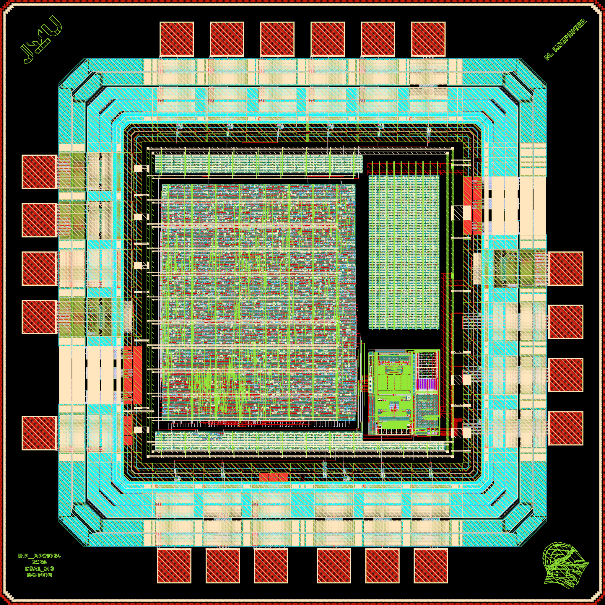

# The DSADC1 Digital Back End on the ihp-sg13cmos5l Open-PDK

[](LICENSE)

(c) 2026 Michael Koefinger

Institute for Integrated Circuits and Quantum Computing, Johannes Kepler University (JKU), Linz, Austria

The chip carries the digital back end of the DSADC1 delta-sigma ADC: the 128x decimation filter, the SPI slave and the configuration register file, hardened on ETH Zurich's EZ130 8T standard cells. Next to it sits `dsm2_core`, a first-order delta-sigma modulator on its own 1.5 V supply, in a pad ring segment of its own. 21 bondpads on a 1.3 mm die, 20 of them bonded.

The flow, the directory layout and the two example macros come from the [ihp-sg13cmos5l AMS chip template](https://github.com/iic-jku/ihp-sg13cmos5l-ams-chip-template) by Simon Dorrer and Harald Pretl, Apache-2.0 WITH SHL-2.1. `CITATION.cff` and the per-file SPDX headers record that lineage.

> [!IMPORTANT]
> The EZ130 8T v1.1 cell library (ETH Zurich, Apache-2.0) is in `ip/ez130_8t_v1p1`, and its thick-oxide decoupling in `ip/ez130_8t_decap_hv`. The builds read them through `EZ130_DIR` and `DECAPHV_DIR`, which default to those folders.

> [!IMPORTANT]
> Every target runs inside the [IIC-OSIC-TOOLS](https://github.com/iic-jku/IIC-OSIC-TOOLS) container, the pinned images of `scripts/image.env` (amd64 built 2026-10-08 with PDK `5eddf3e`, arm64 built 2026-10-15 with PDK `a49358c`, `doc/dsm2_integration.md` section Tools), with `PDK=ihp-sg13cmos5l`. A parse-time guard in each `Makefile` stops the run if the PDK is wrong.

<p align="center">
  <a href="render/img/sg13cmos5l_dsa1_dig_top_black.png">
    
  </a>
  <br>
  <em>sg13cmos5l_dsa1_dig_top, 1.3 mm x 1.3 mm.</em>
</p>


## What is on the die

| | |
|---|---|
| Technology | IHP SG13CMOS5L, Metal1 to Metal4 plus TopMetal1 |
| Standard cells | ETH EZ130 8T, 1.2 V core, 3.3 V I/O ring |
| Die | 1.3 mm square, 21 bondpads, 20 of them bonded |
| Package | QFN24, 4 x 4 mm, 0.5 mm pitch, packaged by IHP, bond plan in [packaging/result.md](packaging/result.md) |
| Macros | `dsa1_dig_top`, 409.08 x 514.08 um at 68.9 % utilization, `dsm2_core`, 150.5 x 178 um, dsm2's oscillator variant of 2026-11-02, and `decap_vdda`, 150.36 x 349.44 um of decap on VDDA |
| Decoupling | VDD 82.21 pF, VDDA 67.61 pF, thick-oxide DECAPHV only |
| Release | [release/v.1.2.1](release/v.1.2.1), delivery GDS `MPC9724.gds.gz`, dsm2 on by default |
| Supplies | VDD 1.2 V, VDDA 1.5 V for dsm2, IOVDD 3.3 V |
| Clock | 65536 Hz sample clock, 200 kHz SPI in a second domain |
| Output rate | 512 Hz, read over SPI as a 22-bit word |
| Power at typical | 3.075 uW, of which 1.171 uW leakage (`dsa1_dig_top`) |

Fourteen signals leave the die: `clk`, `rst_n`, the 1-bit modulator bitstream, the four SPI lines and the conversion flag for the DSA1 back end, and `dsm_clk`, `do_q`, `do_q_b`, `vi`, `vcm` and `ibias_test` for dsm2. The 145 configuration register bits stay inside, except the 16 that control dsm2, the decimator input mux and the `adc_conv` gate. The register file is kept so the taped area is comparable against the earlier `dsa1_dig_top`.

`macros/decimator` hardens the decimator alone for area, power and leakage numbers and is **not** on this chip. `macros/counter` and `macros/inverter` are the template's example blocks, kept as archetypes for `make macro`, and are not on the die either.


## Documentation

- **[doc/specifications.md](doc/specifications.md)**: technology, supplies, clocking, power, and what is and is not verified.
- **[doc/signoff.md](doc/signoff.md)**: the sign-off record of the delivered chip, with IHP's audit dispositions.
- **[doc/Datasheet.md](doc/Datasheet.md)**: the data sheet items, linked to the documents that hold them.
- **[doc/regmap.md](doc/regmap.md)**: the SPI register map.
- **[doc/TRL-Mixed-Signal-IP.md](doc/TRL-Mixed-Signal-IP.md)**: the maturity checklist.
- **[doc/esd_hbm.md](doc/esd_hbm.md)**: the HBM ESD model check.
- **[doc/pinout.md](doc/pinout.md)**: the QFN24 lead table, the pad table per side, the board notes, with the port and the role each pad carries.
- **[doc/floorplan.md](doc/floorplan.md)**: die and core geometry, macro placement, PDN, decoupling.
- **[doc/rtl2gds.md](doc/rtl2gds.md)**: the hardening flow, the metal density rules, the thick-oxide decoupling ban, and how to read each sign-off verdict.
- **[testbenches/README.md](testbenches/README.md)**: what the chip-level benches cover, and why top LVS against a drawn schematic is not the gate here.
- **[models/README.md](models/README.md)**: the bit-true decimator model the RTL and the netlist are gated against.
- **[macros/decimator/README.md](macros/decimator/README.md)**, **[macros/dsa1_dig/README.md](macros/dsa1_dig/README.md)**: per-macro results and open points.
- **[packaging/result.md](packaging/result.md)**: bond plan, wire lengths and skew.
- **[doc/host_protocol.md](doc/host_protocol.md)**: the programs and records of the FPGA master board, and what the chip requires of any bench host.


## Building it

`make help` lists every target with a one-line description, in the top-level `Makefile` and in each macro and IP folder. The usual order:

```sh
make build-macros      # harden decimator and dsa1_dig on EZ130
make build-top         # LibreLane chip assembly, reports, GDS, netlist, render
make add-logo-fill     # metal fill (the generic chip logo is off, see below)
make klayout-drc-regular magic-drc
make sim-rtl-cocotb sim-gl-cocotb
make bondplan
```

The top level also builds for an FPGA, read out over the chip's own SPI slave, see [macros/dsa1_dig/fpga/README.md](macros/dsa1_dig/fpga/README.md). A second board drives it as the chip's surroundings will, owning the sample clock and the bitstream, see [testbenches/fpga/README.md](testbenches/fpga/README.md).

```sh
make -C macros/dsa1_dig synth-fpga   # resource report
make -C macros/dsa1_dig build-fpga   # through to a bitstream, BOARD=ulx3s
```

Per macro:

```sh
make -C macros/decimator sim-gl      # netlist output must equal the RTL
make -C macros/decimator model-gate  # and both must equal the bit-true model
make -C macros/decimator check-netlist power-vcd
```

The template's generic "AMS CHIP" top-metal logo is off, `scripts/add_logo_fill.sh` takes `CHIP_LOGO=1` to put it back. The author block, the JKU logo, the helmet chip art and the title block are IP macros under `ip/`, placed by the floorplan. `ip/sg13cmos5l_ip__jku_names/script/make_names_png.py` regenerates the name, `ip/sg13cmos5l_ip__helm/script/make_helm_png.py` the helmet and `ip/sg13cmos5l_ip__title/script/make_title_png.py` the title.


## IHP submission

The project name is MPC9724, a Mixed-Signal Multi Project Carrier in the IHP Open Source MPW run, repository `michaelk99/IHP__MPC9724`. The metadata is in [doc/info.json](doc/info.json) and the maturity assessment in [doc/TRL-Mixed-Signal-IP.md](doc/TRL-Mixed-Signal-IP.md).

```sh
make release-ihp VERSION=1.2.1    # release/v.1.2.1 with gds/, netlist/, doc/ and ReleaseNote.md
scripts/release_ihp.sh --self-test    # the zero-area check fails on a flat polygon
```

`release/v.1.2.1/` also holds `img/` (renders), `packaging/` (the bond plan) and its `README.md`, added next to what the target writes. `release/v.<version>/gds/MPC9724.gds.gz` is the layout with the top cell renamed, saved with IHP's KLayout options and checked for zero-area polygons. The internal cell name stays `sg13cmos5l_dsa1_dig_top`.


IHP's template expects the sources under `MPC9724-main/`. This repository keeps the sources at the root, the mapping is in [doc/layout_index.md](doc/layout_index.md).

## Verification status

| | |
|---|---|
| Router DRC, KLayout DRC | router zero, 37 recommended bondpad items in the chip's KLayout DRC (sign-off record in [doc/signoff.md](doc/signoff.md)) |
| Metal density, `M<n>Fil.h` and `M<n>Fil.k` | zero window violations, globals 46 to 54 % |
| Netgen LVS, layout against the synthesized netlist | `Circuits match uniquely` |
| Macro RTL against its hardened netlist | `sim-gl`, identical sample for sample, and `lec`, EQY 1325 of 1325 partitions |
| Filter against the bit-true model | 500 of 500 for the decimator, all 8 stimulus modes for the digital top, 0 of 32768 on the full DSM record |
| Clock domain crossing, clk and sclk | `sim-cdc`, every word right from sclk 1.05 to 12.7 times clk at random phase and jitter, RTL and gate level |
| Chip cocotb, RTL and gate level | 13 tests pass, the PSD one opt-in with `PSD=1` |
| HBM ESD, 2 kV | model result at RON 1 and 4 on the tape-out layout: 1.2 V nodes (3.87 V), the VDDA rail (4.38 V), dsm2's analog pins behind its protection (4.41 V) and HV (8.84 V) inside the indicative limits, see [doc/esd_hbm.md](doc/esd_hbm.md) |
| Transistor-level LVS against a drawn schematic | not achievable on this PDK, see [testbenches/README.md](testbenches/README.md) |
| Xschem transient bench | stimulus still the template's, not meaningful yet |


## License

Licensed under the **Solderpad Hardware License v2.1**, see [`LICENSE`](LICENSE).
