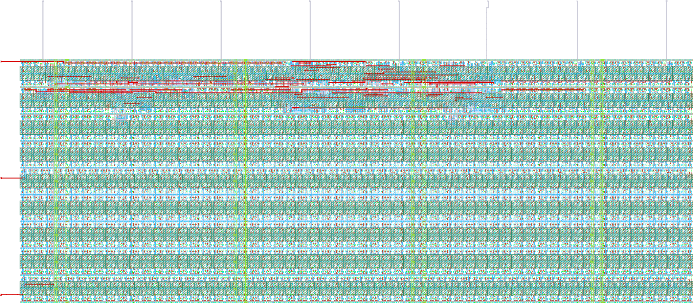

# ihp-sg13cmos5l Counter

<p align="center">
  <a href="render/img/counter_top_white.png">
    
  </a>
  <br>
  <em>Render of the ihp-sg13cmos5l counter layout (200um x 100um).</em>
</p>


## Directory Structure

<details>
<summary>Show Directory Structure</summary>

```text
📁 counter/
├─ 📁 final/
│  ├─ 📁 gds/
│  │  └─ counter_top.gds
│  ├─ 📁 lef/
│  │  └─ counter_top.lef
│  ├─ 📁 lib/
│  │  ├─ 📁 nom_fast_1p32V_m40C/
│  │  ├─ 📁 nom_fast_1p65V_m40C/
│  │  ├─ 📁 nom_slow_1p08V_125C/
│  │  ├─ 📁 nom_slow_1p35V_125C/
│  │  ├─ 📁 nom_typ_1p20V_25C/
│  │  └─ 📁 nom_typ_1p50V_25C/
│  ├─ 📁 nl/
│  │  └─ counter_top.nl.v
│  ├─ 📁 pnl/
│  │  └─ counter_top.pnl.v
│  ├─ 📁 spef/
│  │  └─ 📁 nom/
│  └─ 📁 vh/
│     └─ counter_top.vh
├─ 📁 flow/
│  ├─ 📁 final/               # .gitignore'd LibreLane views: def, gds, json_h, klayout_gds, lef, lib, mag, mag_gds, nl, odb, pnl, render, sdc, sdf, spef, spice, vh, metrics.csv/.json. Key ones are copied to counter/final/
│  └─ 📁 librelane/
│     ├─ config.yaml
│     ├─ impl.sdc
│     ├─ pin_order.cfg
│     └─ signoff.sdc
├─ 📁 fpga/
│  ├─ 📁 arch/                # one fragment per FPGA architecture (ice40, ecp5)
│  ├─ 📁 icebreaker/          # per-board Makefile (device, programmer) and pin constraints
│  ├─ 📁 pico-ice/
│  ├─ 📁 ulx3s/
│  ├─ Makefile                # dispatcher, selects the board with BOARD=
│  ├─ dut.mk                  # RTL sources shared by all boards
│  ├─ fpga.mk                 # the shared flow
│  └─ README.md
├─ 📁 netlist/
│  ├─ 📁 nl/
│  │  └─ counter_top.nl.v
│  ├─ 📁 pnl/
│  │  └─ counter_top.pnl.v
│  ├─ 📁 spice/
│  │  └─ counter_top.spice
│  ├─ 📁 pex/
│  │  ├─ counter_top_klayout_pex_*.spice
│  │  └─ counter_top_magic_pex_*.spice
│  └─ 📁 xspice/
│     └─ counter_top.xspice
├─ 📁 render/
│  ├─ 📁 blender/
│  └─ 📁 img/
│     ├─ counter_top_black.png
│     ├─ counter_top_librelane.png
│     └─ counter_top_white.png
├─ 📁 rtl/
│  ├─ constants.sv
│  ├─ counter.sv
│  └─ counter_top.sv
├─ 📁 schematic/
│  └─ 📁 xschem/
│     ├─ counter_top.sym
│     ├─ counter_top_pex.sym
│     └─ xschemrc
├─ 📁 scripts/
│  ├─ check_pex_ports.py
│  ├─ spi2xspice.py
│  └─ verilog2sym.py
├─ 📁 testbenches/
│  ├─ 📁 cocotb/
│  │  ├─ counter_top_tb.gtkw
│  │  ├─ counter_top_tb.py
│  │  └─ counter_top_tb.surf.ron
│  ├─ 📁 verilog/
│  │  ├─ counter_top_tb.gtkw
│  │  ├─ counter_top_tb.surf.ron
│  │  └─ counter_top_tb.sv
│  └─ 📁 xschem/
│     ├─ 📁 plot_simulations/
│     │  ├─ 📁 data/
│     │  ├─ 📁 figures/
│     │  ├─ ngspice2python.py
│     │  └─ plot_counter_top.py
│     ├─ counter_top_tb_tran.sch
│     └─ xschemrc
├─ 📁 verification/
│  ├─ antenna_summary.rpt
│  ├─ antenna_violations.rpt
│  ├─ stapostpnr_summary.rpt
│  ├─ stapostpnr_nom_fast_1p32V_m40C_power.rpt
│  ├─ stapostpnr_nom_fast_1p65V_m40C_power.rpt
│  ├─ stapostpnr_nom_slow_1p08V_125C_power.rpt
│  ├─ stapostpnr_nom_slow_1p35V_125C_power.rpt
│  ├─ stapostpnr_nom_typ_1p20V_25C_power.rpt
│  ├─ stapostpnr_nom_typ_1p50V_25C_power.rpt
│  ├─ irdrop.rpt
│  ├─ drc.magic.rpt
│  ├─ drc.klayout.json
│  ├─ lvs.netgen.rpt
│  ├─ manufacturability.rpt
│  ├─ stat.rpt
│  ├─ yosys_post_dff.rpt
│  ├─ yosys_pre_techmap.rpt
│  └─ yosys_synth_check.rpt
├─ Makefile
└─ README.md
```

</details>


## Makefile Targets

### Show Available Targets

The default target is `help`, which prints all targets with short descriptions.

```sh
make
make help
```


### PDK Guard

Every target except `help` and `clean` needs the `ihp-sg13cmos5l` PDK. The container starts with `ihp-sg13g2` selected, and a run under the wrong PDK hardens, DRCs and LVSes against the wrong technology while the results look valid. The Makefile checks `$PDK` against `REQUIRED_PDK` at parse time, before any target runs:

```sh
$ make librelane
Makefile:23: *** PDK is "ihp-sg13g2", but this macro needs "ihp-sg13cmos5l". Run `sak-pdk ihp-sg13cmos5l` in this shell and retry, or pass REQUIRED_PDK= to skip this check.  Stop.
```

`open` is not exempt, since Xschem, KLayout and Magic read the selected PDK. `sak-pdk ihp-sg13cmos5l` switches the PDK and also sets `PDKPATH`, `KLAYOUT_PATH`, `SPICE_USERINIT_DIR` and `STD_CELL_LIBRARY`. To run a target against another PDK anyway:

```sh
make <target> REQUIRED_PDK=          # skip the check
make <target> REQUIRED_PDK=<pdk>     # require a different PDK
```


### Open the Design Files

Opens a file browser for this folder with `sak-open.py` from the [IIC-OSIC-TOOLS](https://github.com/iic-jku/IIC-OSIC-TOOLS), one button per design file:

```sh
make open
```

A click launches the tool in the file's own directory:

| File type | Tool |
| --- | --- |
| `.sch`, `.sym` | Xschem |
| `.gds`, `.gds.gz`, `.oas`, `.oas.gz` | KLayout in edit mode |
| `.mag` | Magic |
| `.vcd`, `.fst`, `.gtkw` | GTKWave |
| `.raw` | gaw (ngspice rawfile) |
| `.png`, `.pdf` | the desktop's handler (`xdg-open`) |
| `.sv`, `.svh`, `.v`, `.vh`, `.vhd`, `.vhdl`, `.spice`, `.cir`, `.sp`, `.cdl`, `.sdc`, `.lef`, `.lib`, `.tcl`, `.mk`, `.yaml`, `.json`, `.py`, `.qmd`, `.tex`, `.md` and `Makefile` | gvim |

Other extensions (`.sh`, `.svg`, `.pcf`, `.save`, `.rpt`, `.txt`, `.csv` and so on) get no button. Schematics and symbols of one design unit, the nearest ancestor holding a `Makefile`, share one tabbed Xschem instance that writes its netlists to the folder this macro's [`xschemrc`](schematic/xschem/xschemrc) pins.

The tree is rescanned every 15 s and new files are highlighted for a minute. Skipped by default: `runs/`, `sim_build/`, `obj_dir/`, `simulations/`, `__pycache__/`, `_freeze/` and `.git/`, so the Xschem `.raw` files show up only with `--all`.

```sh
make open OPEN_ARGS=--all              # include the build outputs
make open OPEN_ARGS="--prune backups"  # skip one more directory name
```

At most 400 buttons are drawn, the rest is named at the end of the list. `--all` adds every build output, roughly 19000 files at the top level, 5700 in the counter and 66 in the inverter as counted in the chip template, so use it in the folder you need or narrow it with `--prune`.

> [!NOTE]
> Needs a display: the container's VNC/noVNC desktop or X11 forwarding. In a shell-only container it stops with `cannot open a window`. The `.png` and `.pdf` buttons need the full VNC/noVNC session and do not work over a bare X forward.


### Linting

Lints with [Verilator](https://www.veripool.org/verilator/):

```sh
make lint-verilog                # lint the full counter_top design
make lint-verilog CELL=counter   # lint the standalone counter cell
make lint-verilog-all            # lint counter, then counter_top
```

`CELL=counter_top` (the default) passes all synthesis sources (`constants.sv`, `counter.sv`, `counter_top.sv`). [`rtl/constants.sv`](rtl/constants.sv) holds `` `COUNTER_MAX_DEFAULT `` and `` `CLK_FREQ_DEFAULT `` as `` `define `` macros, because Yosys 0.64 (the template's image) cannot parse `import pkg::*;` in a module header. Macros have no scope, so the file is compiled first: it is always included for a single cell and is the first entry of `MODULES_SIM`, `_SIM_SRCS` and `_LINT_SRCS` in the `Makefile`. `lint-verilog-all` is the lint step of `make all`.


### Verification and Simulation

Uses [cocotb](https://www.cocotb.org/) and [Icarus Verilog](https://github.com/steveicarus/iverilog). The targets take `CELL` (default `counter_top`) and `WAVEFORM_VIEWER=<gtkwave|surfer>` (default `gtkwave`).

> [!NOTE]
> Testbench and viewer files exist only for `counter_top`. Another `CELL` needs its own, for example `testbenches/verilog/<CELL>_tb.*`, `testbenches/cocotb/<CELL>_tb.py` and `testbenches/xschem/<CELL>_tb_tran.sch`.

#### RTL Verilog Simulation

```sh
make sim-rtl-verilog                                   # writes testbenches/verilog/counter_top_tb.vcd
make sim-view-verilog                                  # view counter_top waveform
make sim-view-verilog WAVEFORM_VIEWER=surfer           # use Surfer instead
```

`counter_top` uses the full `MODULES_SIM` list and `testbenches/verilog/counter_top_tb.sv`. Another cell gets `constants.sv` first, then `rtl/<CELL>.sv` (else `.v`) and `testbenches/verilog/<CELL>_tb.sv` (else `.v`). The view target loads the saved layout (`counter_top_tb.gtkw` or `counter_top_tb.surf.ron`) with the current `.vcd`.

#### RTL / GL cocotb Simulation

`testbenches/cocotb/counter_top_tb.py` checks that:

- reset clears the counter to 0
- the counter holds its value while `enable_i` is low
- the counter increments by 1 on every rising clock edge while `enable_i` is high
- the counter wraps from `CTR_MAX` back to 0

```sh
make sim-rtl-cocotb                                   # RTL
make sim-gl-cocotb                                    # gate level, netlist from final/nl/
make sim-view-cocotb                                  # view testbenches/cocotb/sim_build/counter_top.fst
make sim-view-cocotb WAVEFORM_VIEWER=surfer           # use Surfer instead
```

`sim-gl-cocotb` needs the latest implementation in `flow/final/` and `final/nl/counter_top.nl.v` from `make copy-final`. The view target loads the saved `.gtkw` or `.surf.ron` layout.

#### Gate-Level Xschem Simulation

```sh
make sim-gl-xschem                # run counter_top gate-level Xschem simulation
make sim-gl-xschem CELL=<cell>    # run gate-level Xschem simulation for another cell
make sim-gl-xschem TB=<tb>        # run another testbench (default: <CELL>_tb_tran)
```

`TB` is given without `.sch`. Testbenches are in `testbenches/xschem/`, netlists go to `testbenches/xschem/simulations/`.

Each testbench's `SAVE` block includes a FET `.save` file by bare name (e.g. `counter_top_tb_tran.save`, resolved in `testbenches/xschem/simulations/`) with the operating point of every transistor for the `annotate_fet_params` symbols and the `Annotate OP` launcher. `sim-gl-xschem` and the `Simulate` launcher rewrite it on every run, **IHP > Create FET .save file** writes it by hand.

The target runs `xschem netlist` and then `ngspice -b`, so `make` waits for the run and sees its exit status. `plot` commands do nothing in batch mode, so testbenches write results with `wrdata` to `testbenches/xschem/plot_simulations/data/` for `sim-view-xschem`.

> [!NOTE]
> Needs the XSPICE model in `netlist/xspice/`, which `make build-top` generates after `copy-netlist`. To regenerate it by hand:
>
> ```sh
> make generate-xspice
> ```

#### View Xschem Simulation Results

```sh
make sim-view-xschem                      # run the default plotting script (plot_counter_top)
make sim-view-xschem SCRIPT=<scriptname>  # run another plotting script, without .py
```

Runs `SHOW_PLOTS=1 python3 testbenches/xschem/plot_simulations/<SCRIPT>.py`, which writes the figures and a CSV to `testbenches/xschem/plot_simulations/figures/` and opens plot windows when a display is available. Not part of `sim-all`.

#### Run All Simulations

```sh
make sim-all
```

Runs `sim-rtl-verilog`, `sim-rtl-cocotb`, `sim-gl-cocotb` and `sim-gl-xschem` in that order, for `counter_top`. The `sim-view-*` targets are not included, since their GUIs block the shell.


### LibreLane Flow

```sh
make librelane                 # full flow
make librelane-nodrc           # without DRC checks
make librelane-magicdrc        # only Magic DRC checks
make librelane-klayoutdrc      # only KLayout DRC checks
make librelane-openroad        # view the result in the OpenROAD GUI
make librelane-klayout         # view it in KLayout
```

The views are saved under `flow/final/`, which is git-ignored. DRC (Magic and KLayout) and LVS run inside the flow, and `copy-reports` saves them to `verification/`.


### Copy Run Outputs

`copy-reports` needs at least one run in `flow/librelane/runs/`, and the latest must have completed without errors. The other three need their views in `flow/final/`.

| Target | Copies | To |
| --- | --- | --- |
| `make copy-reports` | Yosys synthesis checks, antenna reports, post-PnR timing summary, per-corner power, IR drop, Magic/KLayout DRC, LVS, manufacturability, from `flow/librelane/runs/` | `verification/` |
| `make copy-final` | GDS, LEF, LIB, NL, PNL, SPEF and VH from `flow/final/` | `final/` |
| `make copy-netlist` | SPICE, PNL and NL from `flow/final/spice/`, `pnl/` and `nl/` | `netlist/` |
| `make copy-render` | the render from `flow/final/render/` | `render/img/` |


### Render Top Layout

```sh
make render-gds
```

Renders `final/gds/` (run `make copy-final` first) with `sak-render.py` from the [IIC-OSIC-TOOLS](https://github.com/iic-jku/IIC-OSIC-TOOLS) to `render/img/counter_top_black.png` and `counter_top_white.png`, 2048 px wide, 4x oversampling.


### Build FPGA

`counter_top` is synthesized directly onto board pins, without a board-top wrapper:

| Board | FPGA | Toolchain |
| --- | --- | --- |
| pico-ice (default) | Lattice iCE40UP5K | Yosys -> nextpnr-ice40 -> icepack |
| iCEBreaker | Lattice iCE40UP5K | Yosys -> nextpnr-ice40 -> icepack |
| ULX3S | Lattice ECP5-85F | Yosys -> nextpnr-ecp5 -> ecppack |

```sh
make build-fpga                         # make -C fpga all: clean, lint, synthesis, place-and-route, bitstream
make -C fpga synthesis                  # Yosys synthesis for the default board
make -C fpga pr                         # nextpnr place-and-route
make -C fpga gen_bitstream              # bitstream
make -C fpga flash_bitstream            # write it to the board's flash
make -C fpga BOARD=ulx3s all            # the whole flow on another board
```

> [!NOTE]
> The bitstreams build inside the container. Programming needs the host, since the container has no USB access: run `load_bitstream`/`flash_bitstream` there (`dfu-util` for the pico-ice, `iceprog` for the iCEBreaker, `openFPGALoader` for the ULX3S). Toolchain notes, pin assignments and adding a board: [`fpga/README.md`](fpga/README.md).


### Build Top

```sh
make build-top
```

Runs `librelane`, `copy-reports`, `copy-final`, `copy-netlist`, `generate-xspice`, `copy-render` and `render-gds`.


### Build the Xschem Symbol

The macro has no schematic, so `schematic/xschem/<CELL>.sym` is a hand-written source file. `sak-pin-reorder.py` sorts the ports of the XSPICE model and the PEX netlists into its pin order by `sim_pinname`. No build regenerates it, because testbenches wire to pin coordinates and a moved pin floats silently (auto-named net, valid netlist, wrong result). `symbol-gl` scaffolds a missing symbol, `symbol-check` checks an existing one.

#### Scaffold a New Symbol

```sh
make symbol-gl                  # write schematic/xschem/counter_top.sym
make symbol-gl CELL=<cellname>  # scaffold the symbol of another cell
make symbol-gl FORCE=1          # overwrite an existing symbol
```

[`scripts/verilog2sym.py`](scripts/verilog2sym.py) reads the ports of `netlist/pnl/<CELL>.pnl.v` and writes one pin per port with its direction, bus range and `sim_pinname`:

```text
B 5 -2.5 -82.5 2.5 -77.5 {name=VDD dir=inout sim_pinname=VDD}
B 5 -162.5 -42.5 -157.5 -37.5 {name=clock_i dir=in sim_pinname=clock_i}
B 5 157.5 -42.5 162.5 -37.5 {name=counter_value_o[0..7] dir=out sim_pinname=counter_value_o}
```

The powered netlist is the only one with `VDD` and `VSS`, and it is elaborated (`[7:0]`, not `[CTR_BW-1:0]`), so parameterised RTL is refused. A new macro gets its first symbol from `make build-top` then `make symbol-gl`. Geometry follows Xschem's `make_sym.awk` (inputs left, outputs and inouts right, 5x5 pin boxes on 20-unit stubs, labels at size 0.2), with supplies at top and bottom and a 40 pin pitch. Xschem loads and saves a generated symbol byte for byte. Without `FORCE=1` an existing symbol, the only copy of the hand work, is not overwritten.

House style is left to you. For the counter:

| | scaffold | committed `counter_top.sym` |
| --- | --- | --- |
| pin names | `clock_i`, `reset_n_i`, `enable_i`, `counter_value_o[0..7]` | `di_clock`, `di_reset_n`, `di_enable`, `do_b[0..7]` |
| pin order | netlist order, enable before reset | reset before enable |
| body | 280 x 120, pins on a 40 pitch | 160 x 160, pins on a 60 pitch |

Renaming pins is safe because `sim_pinname` carries the binding to the netlist.

#### Check the Symbol

```sh
make symbol-check                  # check counter_top.sym
make symbol-check CELL=<cellname>  # check the symbol of another cell
```

Compares the committed symbol against the powered netlist and fails if it no longer describes the macro. It is the first step of `generate-xspice`. `sak-pin-reorder.py` already fails on a pin count mismatch, on a `sim_pinname` naming a port the netlist does not have, and on two pins claiming the same port. `symbol-check` adds:

- **A pin without `sim_pinname`.** One such pin switches `sak-pin-reorder.py` to position matching for the whole symbol, wrong for Magic's alphabetically sorted ports. Here the fallback aborts only because its power map expects `a_VPWR`/`a_VGND` and the netlist has `a_VDD`/`a_VSS`. With other supply names it exits 0 having mapped `enable_i` onto `counter_value_o[0]` and `counter_value_o[7]` onto `reset_n_i`.
- **A direction that disagrees with the netlist.** Nothing downstream reads `dir=`, so it would survive the whole flow.
- **A port missing from the symbol**, reported before any conversion instead of as a pin count mismatch.

Each problem names the file, line and pin, and the target exits non-zero:

```text
[ERROR] schematic/xschem/counter_top.sym:19: pin 'di_clock' is dir=out, but 'clock_i' is an input port of module 'counter_top'.
[ERROR] schematic/xschem/counter_top.sym: module 'counter_top' has the port 'enable_i', but no pin declares sim_pinname=enable_i. Add the pin to the symbol.
```

By hand, on any symbol and netlist pair:

```sh
python3 scripts/verilog2sym.py netlist/pnl/counter_top.pnl.v schematic/xschem/counter_top.sym --check
```


### Build Xschem PEX Symbol

```sh
make symbol-pex                  # build counter_top_pex.sym from counter_top.sym
make symbol-pex CELL=<cellname>  # build the PEX symbol of another cell
```

Writes `schematic/xschem/<CELL>_pex.sym` as a copy of `<CELL>.sym` with `type=subcircuit` changed to `type=primitive`. `counter_top.sym` is already `type=primitive` (its subcircuit comes from the XSPICE model), so only the file name differs. The inherited `format="@name @pinlist @symname"` makes the instance reference `<CELL>_pex`, the `.subckt` name the PEX flow writes, and the inherited pin order and `sim_pinname` are what `sak-pin-reorder.py` sorts the extracted netlist to.

`klayout-pex` and `magic-pex` run `symbol-pex` first, so hand edits to the generated file are lost. Edit `<CELL>.sym` instead.

> [!NOTE]
> Every symbol carries `spectre_format="@name ( @pinlist ) @symname"`, as Xschem writes it (key `a`, `make_sym.awk`). Only the Spectre netlister reads it, which also drives VACASK (`xschem.tcl` sets `vacask "$N"` for `netlist_type spectre`). No target here uses it, but do not strip it: without it a Spectre/VACASK netlist **silently drops** the symbol's instances and writes its `subckt` line with an empty port list.


### Parasitic Extraction (PEX)

Extracts R and C from the final GDS into a post-layout SPICE netlist in `netlist/pex/`, next to the XSPICE model:

| | `generate-xspice` | `magic-pex` / `klayout-pex` |
| --- | --- | --- |
| input | LibreLane's extracted `netlist/spice/<TOP>.spice` | the final layout `final/gds/<CELL>.gds` |
| standard cells | replaced by XSPICE primitives (`d_lut`, `d_dff`, ...) | flattened to transistors |
| parasitics | none, Liberty delays only | R and C from the layout |
| speed | fast, digital event driven | slow, full analog solve |

`EXT_MODE` selects the extraction mode: `1` C-decoupled, `2` C-coupled, `3` full-RC (default). The outputs are `netlist/pex/<CELL>_magic_pex_<EXT_MODE>.spice` and `netlist/pex/<CELL>_klayout_pex_<EXT_MODE>.spice`.

**Magic PEX** uses `sak-pex.sh` (in the IIC-OSIC-TOOLS container):

```sh
make magic-pex
make magic-pex CELL=counter_top
make magic-pex CELL=counter_top EXT_MODE=1
```

**KLayout PEX** uses `kpex`, which runs Magic internally:

> [!WARNING]
> `kpex` does not support the `ihp-sg13cmos5l` PDK yet, so the `klayout-pex` target currently fails. Use `magic-pex` until kpex gains CMOS5L support.

```sh
make klayout-pex
make klayout-pex CELL=counter_top EXT_MODE=1
```

kpex does not support `EXT_MODE=1` yet and falls back to `EXT_MODE=2` with a warning.

Both read `final/gds/<CELL>.gds`, so run `make build-top` (or at least `make copy-final`) first. They stop if it is missing. `klayout-pex` hands kpex `netlist/spice/<CELL>.spice` as reference netlist, since there is no schematic.

For `EXT_MODE=3`, `magic-pex` exposes the `extresist` parameters of `sak-pex.sh` (ignored in `EXT_MODE=1`/`2`):

| Variable | `sak-pex.sh` option | Default | Meaning |
| --- | --- | --- | --- |
| `THRESHOLD` | `-t` | `10000` mOhm | only nets above this resistance are split into an RC network |
| `MINRES` | `-r` | `1000` mOhm | resistors below this value are merged away |
| `MINDELAY` | `-y` | `1` ps | nets with a smaller RC delay are not split (`0` = gate by resistance only) |

```sh
make magic-pex CELL=counter_top EXT_MODE=3 THRESHOLD=5000 MINRES=500 MINDELAY=2
```

The `.subckt` is named `<CELL>_pex` (`magic-pex` passes `-n <CELL>_pex`, `klayout-pex` renames kpex's `<CELL>`). Its pins are reordered to `<CELL>_pex.sym` by `sim_pinname`, then [`scripts/check_pex_ports.py`](scripts/check_pex_ports.py) fails the target if a pin does not reach the circuit, see [`macros/inverter/README.md`](../inverter/README.md) for the two cases it catches.

For `counter_top` the full-RC default takes a few seconds. The committed `netlist/pex/counter_top_magic_pex_3.spice` holds 4351 transistors, 2113 capacitors and 4705 resistors in 650 kB.

> [!NOTE]
> Magic's `extresist` step is not deterministic. Four `make magic-pex` runs on the same GDS of the SG13G2 template's counter gave 4401 transistors each, 2079 to 2095 capacitors and 4609 to 4661 resistors, with renumbered internal nodes. So the committed `netlist/pex/counter_top_magic_pex_3.spice` shows as modified in `git status` after every run.

For a **post-layout simulation**, open [`testbenches/xschem/counter_top_tb_tran.sch`](testbenches/xschem/counter_top_tb_tran.sch). It includes the XSPICE model and `netlist/pex/counter_top_magic_pex_3.spice`, and parks `x2` (`counter_top.sym`) and `x3` (`counter_top_pex.sym`) with `spice_ignore=true`. Swap the wired-up `x1` for the one you want.

It runs with `.options savecurrents klu method=gear reltol=1e-3 abstol=1e-12 gmin=1e-12 rshunt=1e14`. With the analog macro's `reltol=1e-4 abstol=1e-15 gmin=1e-15`, full-RC nodes without a DC path to ground abort the run at the initial timepoint with `Timestep too small; trouble with node ...`. The XSPICE output is identical either way.

> [!WARNING]
> In the IIC-OSIC-TOOLS container, 60 ns of post-layout transient take about 80 s, the full 10 µs XSPICE run of the same testbench under 2 s. Use the PEX netlist only on short stimuli for timing and signal integrity.


### Lint, Build, Verify and Simulate All

```sh
make all
```

Runs `lint-verilog-all`, `build-fpga`, `build-top`, `magic-pex` and `sim-all` in that order, so the gate-level simulations use the netlists, XSPICE model and PEX netlist of this build. `klayout-pex` is commented out in the recipe, since nothing in the flow consumes a second extraction and kpex does not support `ihp-sg13cmos5l` yet (see [Parasitic Extraction (PEX)](#parasitic-extraction-pex)). DRC and LVS run inside the LibreLane flow.


### Generate XSPICE File

```sh
make generate-xspice
```

Builds the XSPICE model for mixed-signal simulation in Xschem from the LibreLane-extracted `netlist/spice/<TOP>.spice` (copied by `make copy-netlist`):

1. `symbol-check` fails the target first if `schematic/xschem/<TOP>.sym` no longer matches the ports, see [Check the Symbol](#check-the-symbol).
2. `spi2xspice.py` replaces every standard cell with an XSPICE primitive (`d_lut`, `d_dff`, …), with the pin order from the black-box `.subckt` stubs in the netlist and the logic functions from the Liberty file.
3. `sak-pin-reorder.py` reorders the `.subckt` ports to match `schematic/xschem/<TOP>.sym`.

`make build-top` runs it after `copy-netlist`. The timing parameters (`-io_time`, `-time`, `-idelay`, `-odelay`, `-cload`) are pinned in the Makefile, so regeneration is deterministic.

#### What You Must Consider

**1. Power nets must not collide with the testbench `.GLOBAL` nets.**
The testbench declares `.GLOBAL VDD`, and a digital node named `VDD` would merge with it and abort ngspice with `singular matrix: check node auto_dac...`. `spi2xspice.py` bridges every power (and otherwise unused) boundary net to a private `dig_<net>` node, mind this when adapting the script or renaming supplies.

**2. Symbol pins must declare their netlist name via `sim_pinname`.**
Magic sorts the top-level ports alphabetically, so `sak-pin-reorder.py` maps pins by name. Every pin in `schematic/xschem/<TOP>.sym` needs `sim_pinname=<netlist_name>`, for example:

```
B 5 ... {name=di_clock   dir=in    sim_pinname=clock_i}
B 5 ... {name=do_b[0..7] dir=out   sim_pinname=counter_value_o}
B 5 ... {name=VDD        dir=inout sim_pinname=VDD}
```

The XSPICE pin is derived from it (`clock_i` → `a_clock_i`, `counter_value_o[0]` → `a_counter_value_o_0_`). A bus `sim_pinname` may be the bare base (`counter_value_o`), the symbol's bus indices are applied.

> [!NOTE]
> A new port needs a symbol pin with `sim_pinname` equal to the netlist signal name. `make symbol-check` checks this on every build, and `sak-pin-reorder.py` aborts with `expects XSPICE pin ... which is not in the .subckt`. A pin without `sim_pinname` triggers positional matching, which is correct only when the netlist keeps the symbol's port order (e.g. a Yosys `.nl.v` fed through `vlog2Verilog`), see [Check the Symbol](#check-the-symbol).

Then run `make sim-gl-xschem`, see [Gate-Level Xschem Simulation](#gate-level-xschem-simulation).


### Clean

`make clean` deletes all generated files and folders. It keeps the RTL, schematics, symbols, testbenches, scripts, the LibreLane and FPGA configurations and `render/blender/`. Deleted are:

- `flow/librelane/runs/` and `flow/final/`
- `final/` (GDS, LEF, Liberty, NL, PNL, SPEF and Verilog header deliverables)
- `netlist/` (NL, PNL, SPICE, XSPICE and the extracted PEX netlists)
- `render/img/`
- `verification/`
- `schematic/xschem/simulations/`, `testbenches/xschem/simulations/` and the `plot_simulations/` outputs (`data/`, `figures/`, `__pycache__/`)
- `testbenches/cocotb/sim_build/`, the Icarus Verilog waveforms in `testbenches/verilog/`, and the `__pycache__` folders under `scripts/` and `testbenches/cocotb/`
- the FPGA outputs of every board (`fpga/<board>/build/`), via `make clean` in [`fpga/`](fpga/)

Every target recreates its output folders, so a clean rebuild is:

```sh
make clean
make all
```

> [!WARNING]
> Most of these outputs are committed, so `make clean` leaves a large deletion set in `git status`. `git restore .` brings the tracked ones back. The run directories under `flow/librelane/runs/` are **not** tracked and cannot be restored that way.

> [!NOTE]
> The Xschem testbench `.include`s `netlist/xspice/counter_top.xspice` and `netlist/pex/counter_top_magic_pex_3.spice`, and the gate-level cocotb run needs `netlist/`. After `make clean`, run `make build-top` **and** `make magic-pex` (or `make all`) before `make sim-gl-xschem` or `make sim-gl-cocotb`.


## Start a New Digital Macro from This Template

The counter carries the full digital flow: SystemVerilog RTL, Verilator lint, Icarus Verilog and cocotb simulation, LibreLane hardening with its SDC files and pin order, XSPICE model generation for Xschem, and FPGA emulation on three boards. `make macro FROM=counter NAME=<name>` in [`macros/`](../) copies and renames it, including `TOP` in every `fpga/<board>/Makefile` and `DESIGN_NAME` in the LibreLane config. See [Start a New Macro from an Existing One](../README.md#start-a-new-macro-from-an-existing-one) for the remaining steps and the registration at the chip top-level.
