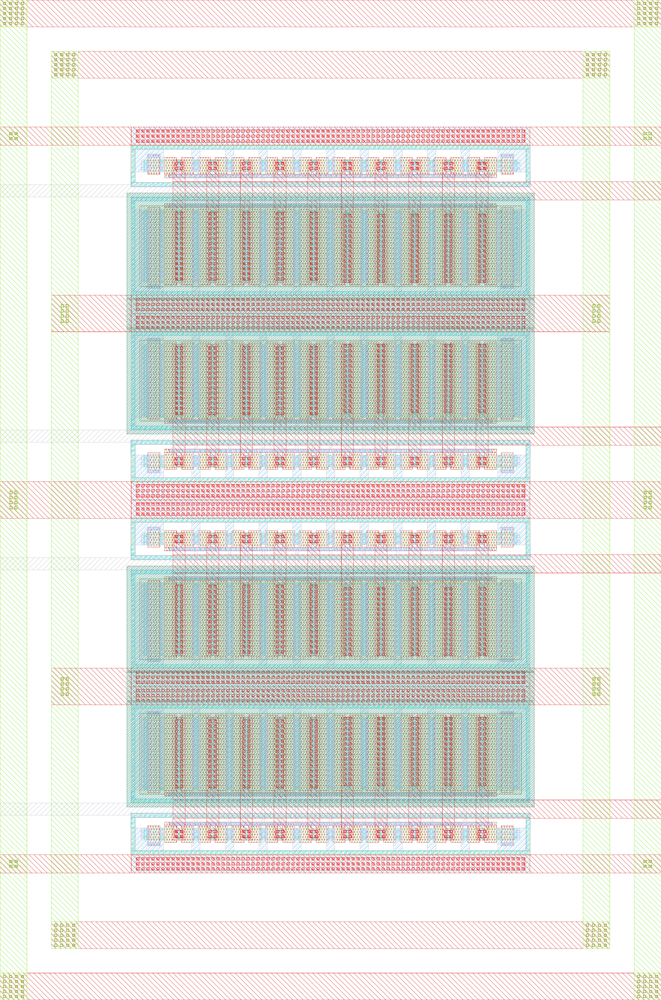

# ihp-sg13cmos5l Inverter

<p align="center">
  <a href="render/img/inverter_top_white.png">
    
  </a>
  <br>
  <em>Render of the ihp-sg13cmos5l inverter layout (54um x 82um).</em>
</p>

The top cell `inverter_top` is 54.18 µm × 81.92 µm and holds four `inverter` instances. A `VSS` ring frames them and a `VDD` ring sits inside it, both 2.2 µm wide, with the horizontal segments on Metal3 and the vertical segments on Metal4, joined by a 4 × 5 `Via3` array at each of the eight ring corners. The rails of the four inverters reach the vertical segments on Metal3 through ten more `Via3` stacks. TopMetal1 stays out of the macro: the chip's TopMetal1 stripes cross it and feed the ring through the `inverter_top` grid in [pdn_cfg.tcl](../../flow/librelane/pdn_cfg.tcl), see [doc/floorplan.md](../../doc/floorplan.md).


## Directory Structure

<details>
<summary>Show Directory Structure</summary>

```text
📁 inverter/
├─ 📁 final/
│  ├─ 📁 gds/
│  │  └─ inverter_top.gds
│  ├─ 📁 lef/
│  │  └─ inverter_top.lef
│  ├─ 📁 lib/
│  │  └─ inverter_top.lib
│  └─ 📁 vh/
│     └─ inverter_top.vh
├─ 📁 layout/
│  ├─ *.gds
│  ├─ *.klay.gds
│  └─ inverter_top.gds
├─ 📁 netlist/
│  ├─ 📁 layout/
│  │  ├─ *.cir
│  │  ├─ *.ext.spc
│  │  ├─ inverter_top_klayout.cir
│  │  └─ inverter_top_magic.ext.spc
│  ├─ 📁 pex/
│  │  ├─ *.spice
│  │  ├─ inverter_top_klayout_pex_*.spice
│  │  └─ inverter_top_magic_pex_*.spice
│  └─ 📁 schematic/
│     ├─ *.cdl
│     ├─ *.spice
│     ├─ inverter_top_klayout.cdl
│     └─ inverter_top_magic.spice
├─ 📁 render/
│  ├─ 📁 blender/
│  └─ 📁 img/
│     ├─ inverter_top_black.png
│     └─ inverter_top_white.png
├─ 📁 schematic/
│  └─ 📁 xschem/
│     ├─ *.sch
│     ├─ *.sym
│     ├─ inverter_top.sch
│     ├─ inverter_top.sym
│     ├─ inverter_top_pex.sym
│     └─ xschemrc
├─ 📁 scripts/
│  ├─ 📁 sizing/
│  │  ├─ 📁 data/
│  │  ├─ 📁 figures/
│  │  ├─ lookup_commands.ipynb
│  │  └─ sizing_inverter.ipynb
│  ├─ check_boundary.py
│  └─ check_pex_ports.py
├─ 📁 testbenches/
│  └─ 📁 xschem/
│     ├─ 📁 plot_simulations/
│     │  ├─ 📁 data/
│     │  ├─ 📁 figures/
│     │  ├─ ngspice2python.py
│     │  ├─ plot_inverter.py
│     │  └─ plot_inverter_top.py
│     ├─ *_tb_*.sch
│     ├─ inverter_tb_ac_ol.sch
│     ├─ inverter_tb_tran.sch
│     ├─ inverter_tb_dc_vout.sch
│     ├─ inverter_top_tb_tran.sch
│     └─ xschemrc
├─ 📁 verification/
│  ├─ 📁 cace/
│  │  ├─ 📁 results/
│  │  ├─ 📁 scripts/
│  │  ├─ 📁 templates/
│  │  └─ inverter.yaml
│  ├─ 📁 drc/
│  │  ├─ 📁 *.klayout.drc/
│  │  ├─ 📁 *.magic.drc/
│  │  ├─ 📁 inverter_top.klayout.drc/
│  │  └─ 📁 inverter_top.magic.drc/
│  └─ 📁 lvs/
│     ├─ 📁 *.klayout.lvs/
│     ├─ 📁 *.magic.lvs/
│     ├─ 📁 inverter_top.klayout.lvs/
│     └─ 📁 inverter_top.magic.lvs/
├─ Makefile
└─ README.md
```

</details>


## Makefile Targets

### Show Available Targets

`make` (same as `make help`) prints all targets.

```sh
make <target> [CELL=<cellname>] [EXT_MODE=<1|2|3>] [THRESHOLD=<mOhm>] [MINRES=<mOhm>] [MINDELAY=<ps>] [DRC_LEVEL=<precheck|macro|regular>] [EV_PRECISION=<digits>]
```

`CELL` defaults to `inverter_top`. `sim-xschem` also takes `TB=<testbenchname>` (default `<CELL>_tb_tran`), `sim-view-xschem` takes `SCRIPT=<scriptname>` (default `plot_<CELL>`).


### PDK Guard

Every target except `help` and `clean` needs `ihp-sg13cmos5l`. The container starts with `ihp-sg13g2`, under which DRC, LVS and Magic would silently use the wrong rule deck and `magicrc`. The Makefile compares `$PDK` with `REQUIRED_PDK` at parse time, before any target runs:

```sh
$ make klayout-drc
Makefile:21: *** PDK is "ihp-sg13g2", but this macro needs "ihp-sg13cmos5l". Run `sak-pdk ihp-sg13cmos5l` in this shell and retry, or pass REQUIRED_PDK= to skip this check.  Stop.
```

`open` is not exempt, because Xschem, KLayout and Magic read the selected PDK. `sak-pdk ihp-sg13cmos5l` switches the PDK and also sets `PDKPATH`, `KLAYOUT_PATH`, `SPICE_USERINIT_DIR` and `STD_CELL_LIBRARY`.

```sh
make <target> REQUIRED_PDK=          # skip the check
make <target> REQUIRED_PDK=<pdk>     # require a different PDK
```


### Open the Design Files

`make open` opens a file browser (`sak-open.py` from the [IIC-OSIC-TOOLS](https://github.com/iic-jku/IIC-OSIC-TOOLS)) with one button per design file. A click starts the tool in the file's own directory:

| File type | Tool |
| --- | --- |
| `.sch`, `.sym` | Xschem |
| `.gds`, `.gds.gz`, `.oas`, `.oas.gz` | KLayout in edit mode |
| `.mag` | Magic |
| `.vcd`, `.fst`, `.gtkw` | GTKWave |
| `.raw` | gaw (ngspice rawfile) |
| `.png`, `.pdf` | the desktop's handler (`xdg-open`) |
| `.sv`, `.svh`, `.v`, `.vh`, `.vhd`, `.vhdl`, `.spice`, `.cir`, `.sp`, `.cdl`, `.sdc`, `.lef`, `.lib`, `.tcl`, `.mk`, `.yaml`, `.json`, `.py`, `.qmd`, `.tex`, `.md` and `Makefile` | gvim |

Other file types get no button. Schematics of one design unit (the nearest ancestor with a `Makefile`) share one tabbed Xschem instance, configured by [`schematic/xschem/xschemrc`](schematic/xschem/xschemrc). The tree is rescanned every 15 s and new files are highlighted for a minute. `runs/`, `sim_build/`, `obj_dir/`, `simulations/`, `__pycache__/`, `_freeze/` and `.git/` are skipped, so the Xschem `.raw` files show up only with `--all`:

```sh
make open OPEN_ARGS=--all              # include the build outputs
make open OPEN_ARGS="--prune backups"  # skip one more directory name
```

At most 400 buttons are drawn. `--all` at the top level found about 19000 files in the chip template, so use it from the folder you need or narrow it with `--prune`.

> [!NOTE]
> Needs a display (the container's VNC/noVNC desktop or X11 forwarding). In a shell-only container it stops with `cannot open a window`. The `.png` and `.pdf` buttons need the full VNC/noVNC session.


### Layout Sources and the Exported Tapeout GDS

`layout/<TOP>.klay.gds` is the source of truth. It references the PDK PCells and pulls in the `inverter` cell through `layout/<TOP>.klay.klib`. `layout/<TOP>.gds` is exported from it with `File > Export Layout For Tapeout`, which turns every PCell and library reference into a static cell, and is what every build and sign-off target reads.

> [!IMPORTANT]
> Re-export after every layout change and never hand-edit `layout/<TOP>.gds`. The sign-off targets read only the export, so drift between the two files goes unseen.

The export re-evaluates the PCells against the installed PDK, so device geometry can change without an edit. For the same stored parameters the installed `SG13_dev` `pmos` draws its `NWell` (`31/0`) 0.11 µm tighter per side than the geometry frozen in the old export, which opened a 0.11 µm gap at the hand-drawn `NWell` straps at `y = 24.53` and `y = 55.09` (four `NW.b1` markers). The straps now abut either revision. The SG13G2 PDK still draws the wider well, so a layout carried between the two templates has to be re-exported under the target PDK. Re-run DRC, LVS and PEX after every export.


### Layout File Extension Usage

`_GDS_EXT` is `.gds` when that file exists, else `.klay.gds`. `klayout-lvs`, `klayout-drc`, `klayout-pex`, `magic-lvs`, `magic-drc` and `magic-pex` read `layout/<name>.$(_GDS_EXT)` (the `sak` scripts take the top cell name from the `<name>.klay.gds` convention). `check-boundary`, `lef`, `copy-gds` and `render-gds` always read `layout/<name>.gds`.


### Run Xschem Testbench Simulation

`sim-xschem` runs one testbench headless: `xschem netlist` into `testbenches/xschem/simulations/`, then `ngspice -b`, so `make` waits for the run and sees its exit status (`xschem simulate` would detach an interactive ngspice). The `plot` commands in `.control` do nothing headless. Every testbench writes its results with `wrdata` to `testbenches/xschem/plot_simulations/data/` for `sim-view-xschem`.

```sh
make sim-xschem                     # default testbench inverter_top_tb_tran
make sim-xschem TB=inverter_tb_ac_ol
make sim-xschem TB=inverter_tb_tran
make sim-xschem TB=inverter_tb_dc_vout
make sim-xschem TB=inverter_top_tb_tran
```

Every testbench includes a FET `.save` file (e.g. `.include inverter_tb_ac_ol.save`) that lists the operating-point parameters of every transistor for the `annotate_fet_params` symbols and the `Annotate OP` launcher. `sim-xschem` and the schematic's `Simulate` launcher rewrite it in `testbenches/xschem/simulations/` on every run, so a fresh clone needs no manual export. **IHP > Create FET .save file** writes it by hand.


### Plot Xschem Simulation Results

```sh
make sim-view-xschem                      # default plot_inverter_top
make sim-view-xschem SCRIPT=plot_inverter
```

Runs `SHOW_PLOTS=1 python3 testbenches/xschem/plot_simulations/<SCRIPT>.py`. Figures go to `testbenches/xschem/plot_simulations/figures/`, and plot windows open when a display is available.


### CACE Simulations

```sh
make sim-cace
```

Runs [CACE](https://github.com/fossi-foundation/cace) on `verification/cace/inverter.yaml` with the parameter sets `ac_mm_params`, `ac_mc_params` and `ac_params` in sequence, then removes `_runs`, `_docs` and `netlist` under `verification/cace/`. Plots in `verification/cace/results/inverter/`: `Adc_ol_dB_mm.png`, `fcu_mm.png`, `Adc_ol_dB_mc.png`, `fcu_mc.png`, `Adc_ol_dB_vs_vdd.png`, `fcu_vs_vdd.png`.


### Simulate All

`make sim-all` runs the four `sim-xschem` testbenches above and `sim-cace`. It leaves out `sim-view-xschem`, which blocks the shell until its window is closed.


### Build Top Cell

`make build-top` runs `check-boundary`, `lef`, `lib`, `verilog`, `copy-gds` and `render-gds` in sequence.


### PR Boundary Check

`make check-boundary` runs [`scripts/check_boundary.py`](scripts/check_boundary.py): the top cell of `layout/<TOP>.gds` must draw the PR boundary on layer 189 (`prBoundary`), and drawn geometry beyond the box gives a warning. LibreLane's `Magic.StreamOut` takes the bounding box of every macro from this layer, and without it the chip build fails with `Failed to extract PR boundary from GDSII view of macro '<TOP>'`. Keep the box in `<TOP>.klay.gds` so every export carries it, and hide it in renders with `sak-render.py -x`.


### Export LEF

`make lef` writes `final/lef/<TOP>.lef` from `layout/<TOP>.gds` with Magic `-hide`: one `PORT` per pin rectangle (`<Metal>.pin`, datatype 2), the rest of the macro as obstruction. Pin rectangles that merge into an L shape on one layer are dropped without a warning, and the chip PDN then fails with `PDN-0232`. So the ring puts its horizontal segments on Metal3 and its vertical ones on Metal4, and the top-level TopMetal1 stripes land TopVia1 stacks on the Metal4 segments. After a layout change, check that the LEF lists all four segments of each supply net as `PORT`, two on `Metal3` and two on `Metal4`.


### Liberty Timing Library

`make lib` writes a Liberty stub `final/lib/<TOP>.lib` with default thresholds.


### Verilog Stub

`make verilog` writes `final/vh/<TOP>.vh` from the `.subckt <TOP>_pex` pin list of the first existing file of `netlist/pex/<TOP>_magic_pex_{1,2,3}.spice`, then `netlist/pex/<TOP>_klayout_pex_{1,2,3}.spice`, so run `make magic-pex` or `make klayout-pex` first. Supply pins (`VDD`, `VSS`, `VPWR`, `VGND`, `VNB`, `VPB`) become `inout` under `` `ifdef USE_POWER_PINS ``, `di_*` pins `input`, `do_*` pins `output`, all others `inout`.


### Copy GDS

`make copy-gds` copies `layout/<TOP>.gds` to `final/gds/`.


### Render Layout Image

`make render-gds` renders the top-level GDS with `sak-render.py` into `render/img/inverter_top_black.png` and `inverter_top_white.png` (2048 px wide, 4x oversampling).


### Design Rule Check (DRC)

`klayout-drc` and `magic-drc` run `sak-drc.sh` on `layout/<CELL>.$(_GDS_EXT)`. Reports go to `verification/drc/<CELL>.klayout.drc/` (`.lyrdb`) and `verification/drc/<CELL>.magic.drc/`, both wiped at the start of each run. `DRC_LEVEL` (`sak-drc.sh -l`) selects the KLayout level: `precheck` for fast iteration, `macro` (default) for a block alone, `regular` for full-chip sign-off. Magic ignores it and always runs the full rule set of the PDK's Magic tech file.

| Check | `precheck` | `macro` _(default)_ | `regular` |
| --- | :---: | :---: | :---: |
| FEOL + BEOL core rules | ✓ | ✓ | ✓ |
| Off-grid / angle | – | ✓ | ✓ |
| Zero-area / geometry | – | ✓ | ✓ |
| Pin / label | – | ✓ | ✓ |
| Recommended / extra rules | – | – | ✓ |
| Density (full-chip fill) | – | – | ✓ |
| Antenna | – | – | ✓ |

```sh
make klayout-drc
make klayout-drc CELL=inverter_top DRC_LEVEL=regular
make magic-drc                       # all subcells flattened (sak-drc.sh -f "*")
make magic-drc CELL=inverter_top
```


### Export Schematic Netlist for LVS

Writes the Xschem netlist to `netlist/schematic/`: CDL for KLayout (`lvs_netlist 1`), SPICE for Magic and Netgen (`lvs_netlist 0`), both with `spiceprefix 1`, `top_is_subckt 1` and `lvs_ignore 1`. `EV_PRECISION` (default 5) sets the significant digits of Xschem's `ev`. Raise it when LVS mismatches come from rounding between Xschem and KLayout ([xschem#465](https://github.com/StefanSchippers/xschem/issues/465)). `ntap` and `ptap` are ignored in both flows (KLayout runs with `--disable_tap_extraction` to match Magic and Netgen).

```sh
make klayout-lvs-netlist
make klayout-lvs-netlist CELL=inverter_top EV_PRECISION=5
make magic-lvs-netlist
make magic-lvs-netlist CELL=inverter_top EV_PRECISION=5
```


### Layout Versus Schematic (LVS)

`klayout-lvs` and `magic-lvs` export the schematic netlist, then run `sak-lvs.sh` on `layout/<CELL>.$(_GDS_EXT)` against `netlist/schematic/`. KLayout mode (`-k`) wraps `run_lvs.py` of the IHP Open-PDK. Magic mode (`-m`, default) extracts with Magic and compares with Netgen using the PDK's Netgen setup. Reports go to `verification/lvs/<CELL>.klayout.lvs/` (`.lvsdb`) and `verification/lvs/<CELL>.magic.lvs/`, both wiped at the start of each run. The extracted layout netlist goes to `netlist/layout/`.

```sh
make klayout-lvs
make klayout-lvs CELL=inverter_top
make magic-lvs
make magic-lvs CELL=inverter_top
```


### Build Xschem PEX Symbol

```sh
make symbol-pex                  # build inverter_top_pex.sym from inverter_top.sym
make symbol-pex CELL=<cellname>
```

Copies `schematic/xschem/<CELL>.sym` to `<CELL>_pex.sym` with `type=subcircuit` changed to `type=primitive`. Xschem then does not look for a schematic, and the instance (`format="@name @pinlist @symname"`) references `<CELL>_pex`, the `.subckt` of the included PEX netlist, in the pin order `sak-pin-reorder.py` uses. `klayout-pex` and `magic-pex` run it first, so the symbol cannot go stale. Make changes in `<CELL>.sym`: hand edits to `<CELL>_pex.sym` are lost at the next extraction. Without `<CELL>.sym` the target prints a note and does nothing, and PEX runs without a pin reorder. It fails only when `<CELL>.sym` has neither `type=subcircuit` nor `type=primitive`.

> [!NOTE]
> Every symbol carries `spectre_format="@name ( @pinlist ) @symname"`. Only the Spectre netlister reads it, which also drives VACASK. ngspice and every target here ignore it. Do not strip it: without it a Spectre/VACASK netlist silently drops the instances of the symbol and gives its `subckt` line an empty port list.


### Parasitic Extraction (PEX)

`klayout-pex` and `magic-pex` extract `layout/<CELL>.$(_GDS_EXT)` into `netlist/pex/<CELL>_klayout_pex_<EXT_MODE>.spice` and `netlist/pex/<CELL>_magic_pex_<EXT_MODE>.spice`. `EXT_MODE` is `1` C-decoupled, `2` C-coupled or `3` full-RC (default). The `.subckt` is named `<CELL>_pex` (`sak-pex.sh -n` for Magic, renamed from `<CELL>` for kpex). Both targets run `symbol-pex` first and reorder the `.subckt` pins with `sak-pin-reorder.py` to that symbol, so the netlist drops into the Xschem symbol in any `EXT_MODE`.

Both finish with [`scripts/check_pex_ports.py`](scripts/check_pex_ports.py), which fails the target when a `.subckt` pin does not reach the circuit. ngspice reads both cases without a warning:

- A declared port that no element references. Whatever is wired to it from outside floats.
- A port whose net `extresist` (`EXT_MODE=3`) split into `<port>.t<n>` and `<port>.n<n>` fragments, none of them connected back to the port.

```sh
python3 scripts/check_pex_ports.py netlist/pex/inverter_top_magic_pex_2.spice
python3 scripts/check_pex_ports.py -v netlist/pex/*.spice     # -v also prints the size of each subcircuit
```

> [!WARNING]
> `klayout-pex` uses `kpex` with its Magic engine, and `kpex` does not support `ihp-sg13cmos5l` yet, so the target fails and `klayout-verify` has it commented out. Use `magic-pex`. In `klayout-pex`, `EXT_MODE=1` falls back to `2` with a warning.

```sh
make klayout-pex
make klayout-pex CELL=inverter_top EXT_MODE=3
make magic-pex
make magic-pex CELL=inverter_top EXT_MODE=3
```

In `EXT_MODE=3`, `magic-pex` passes three `extresist` filters of `sak-pex.sh`, in this order:

1. `THRESHOLD` (`-t`, mOhm, default `10000` = 10 Ohm): nets whose worst-case resistance estimate stays below it are not extracted.
2. `MINDELAY` (`-y`, ps, default `1`): an extracted net whose RC delay stays below it loses its resistor network again. `MINDELAY=0` applies `THRESHOLD` a second time instead, to the extracted resistance.
3. `MINRES` (`-r`, mOhm, default `1000` = 1 Ohm): neighbouring resistors below it inside a net are merged.

Higher values give a smaller, faster and less detailed netlist.

```sh
make magic-pex CELL=inverter_top EXT_MODE=3 THRESHOLD=5000 MINRES=500 MINDELAY=2
```


### Verify with KLayout

DRC and LVS in sequence (`klayout-pex` is commented out, see the warning above), for one cell or for `inverter` and `inverter_top`:

```sh
make klayout-verify
make klayout-verify CELL=inverter
make klayout-verify-all
```


### Verify with Magic

```sh
make magic-verify
make magic-verify CELL=inverter
make magic-verify-all
```


### Verify, Build and Simulate All

```sh
make all
```

Runs `klayout-verify-all`, `magic-verify-all`, `build-top` and `sim-all`, in this order, so the Verilog stub and the `inverter_top` testbench use the PEX netlist of this run.


### Clean

`make clean` deletes `final/`, `netlist/`, `render/img/`, `verification/drc/`, `verification/lvs/`, `schematic/xschem/simulations/`, `testbenches/xschem/simulations/`, the `plot_simulations/` outputs (`data/`, `figures/`, `__pycache__/`) and the CACE outputs under `verification/cace/` (`_runs/`, `_docs/`, `netlist/`, `results/`, `templates/simulations/`). Sources stay. Every target recreates its folders:

```sh
make clean
make all
```

> [!WARNING]
> Most of these outputs are committed, so `make clean` leaves a large deletion set in `git status`. `git restore .` brings them back.

> [!NOTE]
> All four testbenches and `make verilog` read a Magic PEX netlist from `netlist/pex/`. After `make clean`, run `make magic-pex` (or `make all`) before `make sim-xschem`, `make sim-all` or `make build-top`.


## Start a New Analog Macro from This Template

`make macro FROM=inverter NAME=<name>` in [`macros/`](../) copies the inverter with its full analog flow and renames it, including the cells inside the GDS files and the `.klib` library map. See [Start a New Macro from an Existing One](../README.md#start-a-new-macro-from-an-existing-one) for what is left to do and how to register the macro at the chip top-level.
