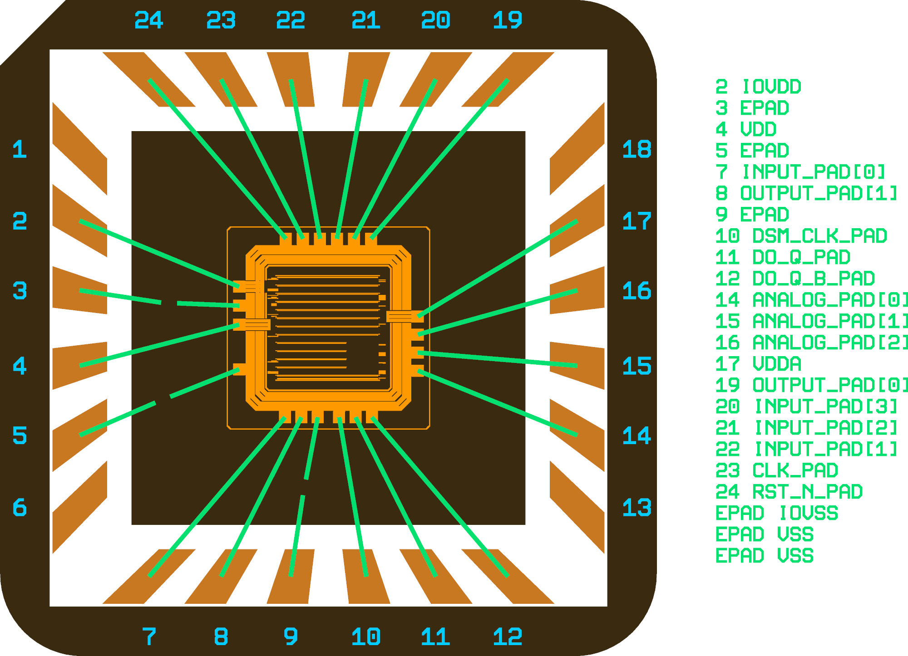

<!--
SPDX-FileCopyrightText: 2026 Harald Pretl, Johannes Kepler University
SPDX-License-Identifier: Apache-2.0 WITH SHL-2.1
Description: Bondplan report for sg13cmos5l_dsa1_dig_top v.1.0.0, generated by scripts/run_bondplan.py
-->

# Bondplan Report - sg13cmos5l_dsa1_dig_top v.1.0.0

Generated by `scripts/run_bondplan.py` on 2026-10-25.

## Summary

| | |
|---|---|
| Design | sg13cmos5l_dsa1_dig_top |
| Package | QFN24_4MM.gds |
| Die size | 1.30 x 1.30 mm |
| Pad pitch / opening | 104 / 65.8 um |
| Bondwires | 23 (17 pad to lead, 3 pad to cavity, 3 lead to cavity) |
| Wire width | 25 um |
| Wire length | 974 .. 1279 um |
| Min wire-to-wire gap | 64 um |
| Max lead skew | 7.7 deg |

## Bond Table

| Pin | Die pad | Die x/y (um) | Package x/y (um) | Length (um) | Angle (deg) | Skew (deg) | Min gap (um) |
|---|---|---|---|---|---|---|---|
| 2 | IOVDD | -545.0 / 252.0 | -1515.3 / 654.1 | 1050.4 | 157.5 | 0.8 | 90.9 |
| 3 | EPAD | -1021.0 / 155.0 | -1515.4 / 230.1 | 500.0 | 171.4 | 0.0 | 75.0 |
| 4 | VDD | -545.0 / 20.0 | -1515.4 / -230.1 | 1002.0 | -165.5 | 5.8 | 91.0 |
| 5 | EPAD | -1056.3 / -456.0 | -1515.3 / -654.1 | 500.0 | -156.7 | 0.0 | 75.0 |
| 7 | input_PAD[0] | -265.0 / -545.0 | -1092.8 / -1515.3 | 1275.5 | -130.5 | 4.7 | 64.3 |
| 8 | output_PAD[1] | -165.0 / -545.0 | -654.1 / -1515.3 | 1086.7 | -116.8 | 3.4 | 64.3 |
| 9 | EPAD | -155.0 / -1021.0 | -230.1 / -1515.4 | 500.0 | -98.6 | 0.0 | 75.0 |
| 10 | dsm_clk_PAD | 65.0 / -545.0 | 230.1 / -1515.4 | 984.3 | -80.3 | 1.0 | 73.6 |
| 11 | do_q_PAD | 165.0 / -545.0 | 654.1 / -1515.3 | 1086.7 | -63.2 | 3.4 | 64.3 |
| 12 | do_q_b_PAD | 265.0 / -545.0 | 1092.8 / -1515.3 | 1275.5 | -49.5 | 4.7 | 64.3 |
| 14 | analog_PAD[0] | 545.0 / -260.0 | 1515.3 / -654.1 | 1047.3 | -22.1 | 1.2 | 84.6 |
| 15 | analog_PAD[1] | 545.0 / -150.0 | 1515.4 / -230.1 | 973.6 | -4.7 | 3.9 | 84.6 |
| 16 | analog_PAD[2] | 545.0 / -40.0 | 1515.4 / 230.1 | 1007.2 | 15.6 | 6.9 | 81.0 |
| 17 | VDDA | 545.0 / 70.0 | 1515.3 / 654.1 | 1132.6 | 31.0 | 7.7 | 81.0 |
| 19 | output_PAD[0] | 260.0 / 545.0 | 1092.8 / 1515.3 | 1278.8 | 49.4 | 4.8 | 67.5 |
| 20 | input_PAD[3] | 156.0 / 545.0 | 654.1 / 1515.3 | 1090.7 | 62.8 | 3.8 | 67.5 |
| 21 | input_PAD[2] | 52.0 / 545.0 | 230.1 / 1515.4 | 986.6 | 79.6 | 1.8 | 77.3 |
| 22 | input_PAD[1] | -52.0 / 545.0 | -230.1 / 1515.4 | 986.6 | 100.4 | 1.8 | 77.3 |
| 23 | clk_PAD | -156.0 / 545.0 | -654.1 / 1515.3 | 1090.7 | 117.2 | 3.8 | 67.5 |
| 24 | rst_n_PAD | -260.0 / 545.0 | -1092.8 / 1515.3 | 1278.8 | 130.6 | 4.8 | 67.5 |
| EPAD | IOVSS | -545.0 / 136.0 | -921.1 / 151.0 | 376.4 | 177.7 | - | 75.0 |
| EPAD | VSS | -545.0 / -252.0 | -963.4 / -418.9 | 450.5 | -158.3 | - | 75.0 |
| EPAD | VSS | -65.0 / -545.0 | -136.4 / -922.8 | 384.4 | -100.7 | - | 73.3 |
